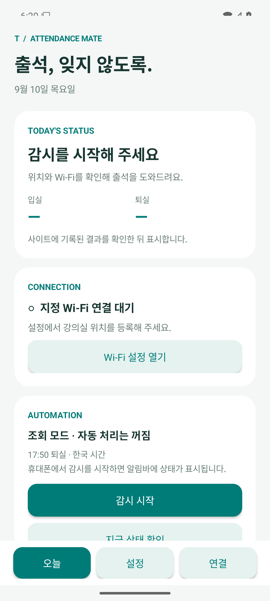
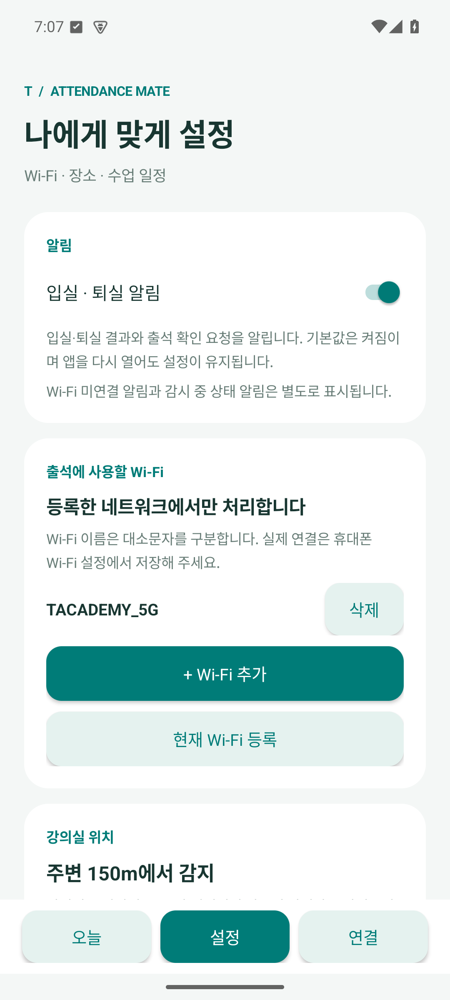

# 출석 메이트 · Classroom Attendance Android

강의실 Wi-Fi와 위치를 확인하고 출석 사이트의 입실·퇴실을 자동 처리하는 개인용 Android 앱입니다.

**v0.1.1은 초기 테스트 버전입니다. 실제 본인 계정과 강의실 네트워크에서 자동 입퇴실 검증이 필요합니다.**

[APK 다운로드 · v0.1.1](https://github.com/dnjsml0206-blip/classroom-attendance-android/releases/tag/v0.1.1)

## 설치와 시작

1. 릴리스의 `classroom-attendance-0.1.1-debug.apk`를 Android 휴대폰에 내려받아 설치합니다. Android 8.0 이상을 지원합니다.
2. **설정 → Wi-Fi**에서 기본 등록된 `TACADEMY_5G`를 확인합니다. 다른 Wi-Fi는 이름을 입력해 추가하거나 삭제할 수 있습니다.
3. 휴대폰 Wi-Fi 설정에도 해당 네트워크를 저장하고 자동 연결을 켭니다. 앱의 목록은 출석에 사용할 네트워크 목록이며 Wi-Fi 비밀번호를 저장하지 않습니다.
4. **설정 → 강의실 위치**에서 현재 위치를 등록하거나 좌표와 반경을 입력합니다.
5. 수업 요일과 입실 시간대를 확인합니다. 기본값은 월–금, 08:00–17:45이며 휴강일을 추가할 수 있습니다.
6. **연결 → 사이트 인증**에서 본인에게 발급된 인증 링크를 앱 안에서 열고 **인증 저장**을 누릅니다. Chrome 인증은 앱과 자동 공유되지 않습니다.
7. 위치·알림·정확한 알람 권한을 허용하고 **오늘 → 감시 시작**을 누릅니다.
8. 초기에는 조회 모드입니다. 지정 Wi-Fi에서 본인의 기록을 확인한 뒤 **설정 → 입실·퇴실 자동 처리**를 켭니다.

**설정 → 알림 → 입실·퇴실 알림**에서 결과와 출석 확인 요청 알림을 켜거나 끌 수 있습니다. 자동 출석은 알림 설정과 별도로 동작합니다. Wi-Fi 미연결 및 감시 상태 알림은 계속 표시됩니다.

개인 인증 링크나 쿠키를 GitHub 이슈에 올리지 마세요. 앱은 인증 정보를 Android Keystore 키로 암호화해 기기에 저장합니다.

<p> </p>

## 구현한 기능

- 기본 Wi-Fi `TACADEMY_5G`; 사용자 추가, 삭제, 현재 연결 이름 등록 및 재실행 후 유지
- 강의실 좌표와 반경 등록; 주변에서 지정 Wi-Fi 미연결 시 알림바 안내
- 사용자가 시작하는 위치·Wi-Fi 감시 서비스와 감시 일시 중지
- 월–일 수업 요일, 입실 시간대, 휴강일 설정
- 한국 시간 **17:50** 퇴실 예약 및 알람 권한 상태 표시
- 설정 → 알림 → 입실·퇴실 알림 켜기/끄기; 기본 켜짐, 재실행 후 유지, 끄면 표시 중인 결과 알림도 제거
- 출석 사이트의 공개 JavaScript에서 확인한 요청을 사용하는 기록 조회와 자동 입퇴실
- 지정 Wi-Fi 네트워크에 연결한 HTTP 요청 및 사이트의 IP 허용 여부 재확인
- 날짜·과정·입실/퇴실별 중복 방지, 결과 불명확 시 조회 우선 및 재전송 보류
- 앱 내 사이트 인증 화면, 기기 내 암호화 인증 저장, 백업 제외
- 사이트 기록에서 확인한 입실·퇴실 시각과 개인정보를 제외한 활동 로그

## 현재 제약

- 일반 Android 앱은 꺼진 Wi-Fi를 직접 켤 수 없습니다. 휴대폰 자동 연결 또는 지원되는 갤럭시의 모드 및 루틴을 함께 사용합니다.
- Chrome의 기존 인증을 자동으로 가져오지 않습니다. 본인 인증 링크를 앱 내부에서 다시 열어야 합니다.
- 공개 코드의 요청 형식은 확인했지만, 실제 계정의 인증 및 허용 Wi-Fi에서의 출석 변경은 검증하지 않았습니다. 서버의 예상 밖 응답은 자동 처리하지 않습니다.
- 입실·퇴실 요청은 서버의 출결일, IP 허용, 과정 진행 상태와 오늘 기록을 먼저 확인합니다. 출석 완료는 HTTP 성공만으로 판정하지 않습니다.
- 17:50은 처리 시작 목표 시각입니다. 실제 서버 기록 시각은 통신과 휴대폰 상태에 따라 달라집니다.
- 재부팅 후 알람을 복구하고 감시 재시작 알림을 보냅니다. 위치·Wi-Fi 감시는 앱을 열어 다시 시작해야 합니다.
- 앱 강제 중지, 권한 철회, 제조사 배터리 제한에서는 정상 감시를 보장할 수 없습니다.
- 이 릴리스는 테스트용 debug 키로 서명한 APK입니다. 정식 배포용 서명·스토어 배포는 포함하지 않습니다.

## 빌드

Android SDK 36, JDK 21과 Gradle Wrapper 9.3.1을 사용합니다.
`local.properties`에 자신의 SDK 경로를 설정하거나 `ANDROID_HOME`을 지정합니다.

```shell
./gradlew testDebugUnitTest lintDebug assembleDebug
```

Windows에서는 `gradlew.bat`를 사용합니다.

출력: `app/build/outputs/apk/debug/app-debug.apk`

GitHub Actions에서도 같은 검사를 수행하고 테스트 APK를 아티팩트로 제공합니다.

## 검증

- 일정·와이파이 이름·사이트 응답·인증 URL 범위에 대한 JVM 테스트 12개 통과
- Android Lint 오류 0개; 고정된 Gradle 버전에 대한 업데이트 안내 1개
- 실제 출석 계정과 강의실 Wi-Fi 검증은 미실행
- 알림 설정 및 업데이트 설치 검증: [v0.1.1 검증](docs/verification-v0.1.1.md)

## 문서

- [상세 요구사항](docs/requirements.md)
- [구조와 상태 전이](docs/architecture.md)
- [Android 설정](docs/android-setup.md)
- [사이트 연동 확인 결과](docs/site-integration.md)
- [개발 순서](docs/roadmap.md)
- [실제 기기 검증 시나리오](docs/acceptance-tests.md)
- [설정 구조 예시](config/attendance.example.json)

설정 JSON은 데이터 구조 예시입니다. 현재 앱은 설정 화면과 SharedPreferences를 사용하며 JSON 가져오기는 지원하지 않습니다.
