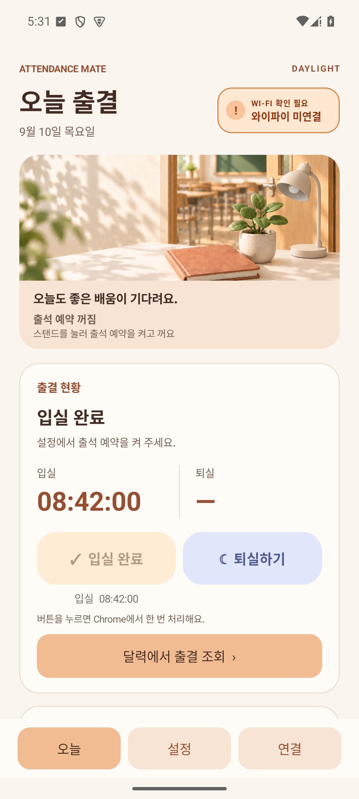
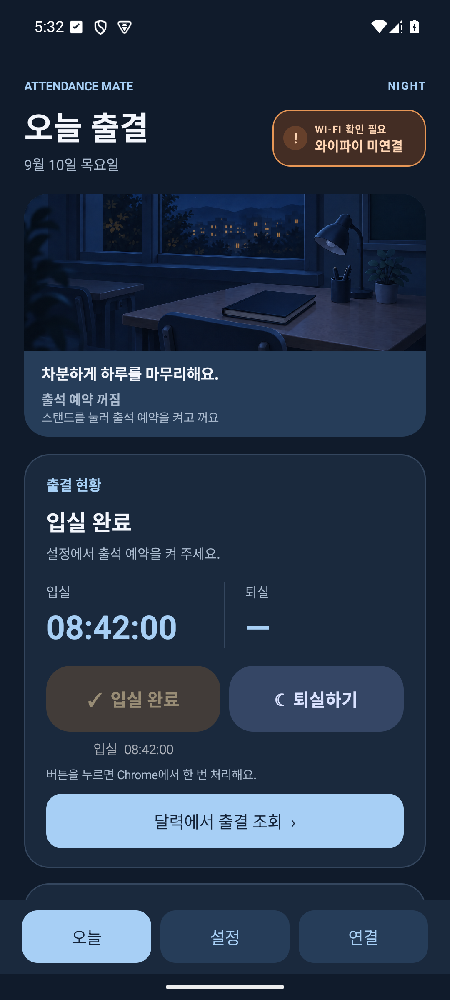
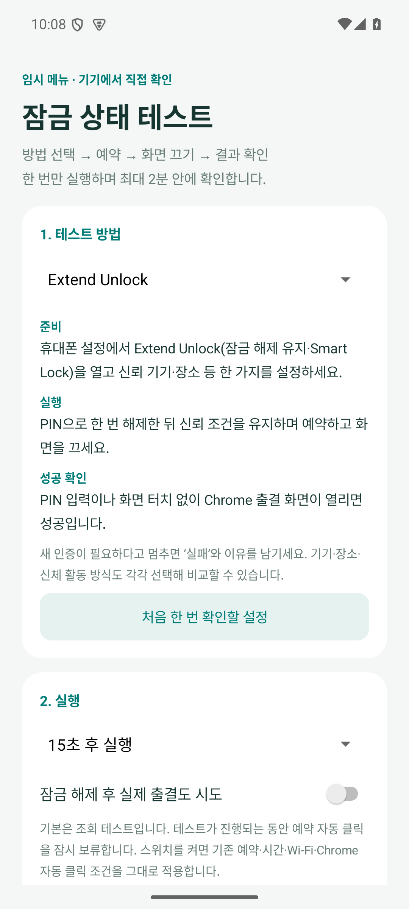
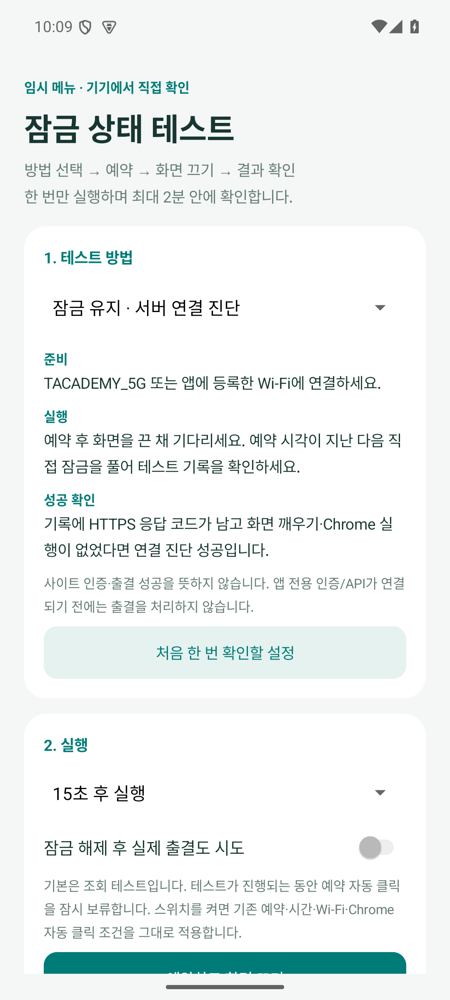

# 출석 메이트 · Android

기존 **휴대폰 Chrome의 인증 상태**로 SK플래닛 출석 버튼을 처리하는 개인용 앱입니다.

[제작자용 APK 다운로드 · v0.9.2](https://github.com/dnjsml0206-blip/classroom-attendance-android/releases/tag/v0.9.2)

**실제 수강생 Chrome 인증과 강의실 Wi-Fi에서 확인이 필요한 초기 테스트 버전입니다.**
설정의 **잠금 중 처리 방식**을 일반 예약에 적용합니다. 기본값은 Extend Unlock · 신뢰 상태이며, 화면 깨우기·시스템 인증 요청도 선택할 수 있습니다. 이전 알림 전용 설정은 Extend Unlock으로 적용됩니다. 실제 휴대폰이 화면 표시를 제한하거나 인증을 요구하면 사용자의 조작이 필요합니다.

## v0.9.2 · 화면 복구와 실패 원인 진단

클릭 전 Chrome 화면 판독이 끊기면 제한된 복구 대기를 적용하고, 일시적인 실패가 계속 보류되는 문제를 보완했습니다. 상세 로그는 휴대폰 화면/접근성 문제와 실제로 관찰된 사이트 오류 문구를 구분합니다. 화면을 읽지 못하면 사이트 차단 여부는 미확정으로 남깁니다. 진단용 서버 요청은 추가하지 않습니다.

오늘 그림의 **스탠드 부분**을 눌러 출석 예약과 조명을 함께 켜고 끕니다. 달력은 **오늘·지난 날짜의 상태와 선택적인 입실·퇴실 시각**을 수기 수정할 수 있으며 사이트 공식 기록은 변경하지 않습니다.

[설치와 변경 내용](docs/releases/v0.9.2.md) · [진단 검증](docs/verification-diagnostics-2026-09-16.md) · [화면 복구 검증](docs/verification-replica-2026-09-16.md)

## 변경한 동작

- 기본 입실 시간 **08:30–09:30**에만 감시하고, 입실 기록이 확인되면 즉시 종료합니다.
- 기본 **17:50:05**부터 다시 시작해 퇴실합니다. 설정한 퇴실 시각보다 **5초 늦게** 시작해 조기 처리를 피하며, 일반 퇴실 예약에 적용합니다. 실패하면 Wi-Fi 연결 요청을 표시하고 기본 최대 **10분** 재시도한 뒤 출결 시도를 종료합니다.
- 설정에서 **입실 시간**을 선택하면 시작·종료 시각을, **퇴실 시간**을 선택하면 퇴실 시각·재시도 시간을 바꿀 수 있습니다. 수업 요일은 별도로 선택합니다.
- 강의실 기본 반경은 **30m**입니다. 이전 기본값 150m도 업데이트 시 30m로 변경합니다.
- 휴강일은 달력에서 추가·삭제합니다.
- 오늘 탭은 따뜻한 교실 일러스트, 출결 현황, 오늘 확인된 입실·퇴실 기록을 표시합니다. 설정 변경·감시 시작과 종료 등 앱 동작 로그는 오늘 화면에 표시하지 않습니다. 현황의 달력 버튼을 누르면 **월간 달력의 각 날짜에 완료·입실·미확인·휴강·예정 상태**가 표시됩니다. 날짜를 선택하면 달력 아래에서 해당 날짜의 입실·퇴실 시각을 확인할 수 있습니다.
- **퇴실 1시간 전부터 자정까지 야간 대시보드**로 자동 전환합니다. 기본 퇴실 17:50이면 **16:50**에 바뀌며, 설정을 바꾸면 전환 시각도 따라갑니다. 입실 시간과 겹치면 입실 종료 후 전환합니다. 한국 시간을 기준으로 화면을 보는 동안 또는 앱 복귀 시 반영하며 별도 백그라운드 작업은 추가하지 않습니다.
- 퇴실이 확인되지 않은 채 강의실을 벗어나면 **퇴실 확인 필요 · 강의실 이탈 감지** 알림을 하루 한 번 보냅니다. 강의실 위치와 위치 항상 허용이 필요하며, GPS 오차를 고려한 연속 두 위치로 판단합니다. **설정한 퇴실 재시도 시간 안에서만** GPS 이탈을 확인합니다(기본 17:50:05–18:00). 퇴실 확인·이탈 알림 발송·재시도 종료 중 먼저 도달한 때 GPS 감시를 종료하며, 이탈 알림 발송 후에도 재시도 시간이 남아 있으면 출결 확인은 계속합니다.
- 기본 Wi-Fi `TACADEMY_5G`; 사용자 추가·삭제를 지원합니다.
- 입실·퇴실 완료 알림은 항상 표시합니다. 날짜별·입실/퇴실별로 남고, 앱을 열거나 감시가 끝나도 자동 삭제하지 않습니다. 직접 지울 수 있으며 휴대폰의 앱 알림과 결과 알림 채널이 허용되어 있어야 합니다.
- 인텔리전트 Wi-Fi 버튼은 기기에서 제공하는 메뉴를 우선 열고, 지원되는 갤럭시에서는 접근성으로 메뉴를 찾아 이동합니다.

<p> </p>

위 화면은 실제 APK를 에뮬레이터에서 실행한 캡처이며 출결 시각과 로그는 화면 검증용 예시 데이터입니다. 설치된 앱에는 예시 기록이 들어가지 않습니다.

## v0.7.0 · 접속 제한과 제작자 진단

앱이 여는 출결·인증 페이지는 수동 열기와 테스트까지 모두 최소 3초 간격, 기기당 하루 최대 20회로 제한합니다. 자동 접속은 입실·퇴실 각각 최대 3회이며 재시도 간격은 2분, 이후 5분입니다. 사이트 오류나 결과 미확인 시 해당 단계의 자동 재접속을 중단하고, 출결 버튼·확인 버튼 요청은 반복하지 않습니다. 기기 연결 진단의 별도 HTTPS 요청도 제거했습니다. 이는 앱의 페이지 열기 횟수 제한이며, 사이트 자체의 HTTP 요청 수나 서버 무부하를 보장하지는 않습니다.

로그 업로드는 **설정 맨 아래 → 진단 · 제작자용 → 로그 확인 · GitHub 업로드**로 이동합니다. **테스트 완료 · 임시 메뉴 숨기기**로 임시 시험만 정리할 수 있고 제작자 업로드는 유지합니다. 기본 빌드는 일반 배포용으로 진단 메뉴와 업로드 실행이 비활성화되며, 제작자용은 `-PcreatorTools=true`로 별도 제작하며, 이번 비공개 저장소의 시험용 릴리스에 제공합니다. 일반 공개 배포에는 포함하지 않습니다. 일반 출결 동작도 최근 7일·최대 200건 및 진단 크기 약 120 KiB 한도 안에서 로컬 진단 로그에 포함하고 마지막 성공 업로드 이후의 새 기록만 올립니다. 오늘 화면은 출결 기록만 표시합니다.

[접속 제한·제작자용 빌드·검증 기준](docs/server-load-and-creator-tools.md) · [로그 업로드](docs/github-log-upload.md)

## v0.7.0 · 지난 출결 직접 입력

오늘 → 달력에서 출결 조회에서 오늘이나 지난 날짜를 선택해 **출석·조퇴·결석과 선택적인 입실·퇴실 시각**을 직접 저장·수정·삭제할 수 있습니다. 8월 31일 등 앱 사용 전 기록도 입력할 수 있고, 날짜별 상태와 월별 합계에 반영됩니다. 직접 입력 표시를 남기며 오늘 자동 출결과 사이트 기록은 변경하지 않습니다. 수기 시간을 입력하지 않은 항목은 확인된 기록을 유지합니다. [사용 방법](docs/monthly-attendance-calendar.md)

## v0.9.0 · 자동화 설정과 대체 클릭 시험

‘알림 후 직접 해제’ 선택지는 제거하고 기본값을 **Extend Unlock · 신뢰 상태**로 변경했습니다. 이전 알림 전용 선택도 자동 방식으로 적용되며, 별도로 선택한 화면 깨우기·시스템 인증 방식은 유지합니다. 입실·퇴실마다 하루 한 번, 최대 2분 시도하며 출석 예약·자동 클릭·등록 Wi-Fi·출석 시간 조건은 계속 적용합니다.

**오늘 화면 맨 아래**에 대상 Wi-Fi를 인식하면 **대기 중**, 인식하지 못하면 **와이파이 미연결**을 표시합니다. 오늘 화면을 보는 동안 갱신하며 출결 서버를 조회하지 않습니다. 이 표시는 Wi-Fi 인식 상태로, 출석 처리 완료나 인터넷 정상 여부를 뜻하지 않습니다.

**설정 맨 아래 → 진단 · 제작자용 → 잠금 상태 테스트 열기**에서 대체 클릭 시험을 실행합니다. 실제 입실·퇴실 시험 대신 Chrome에서 휴대폰 내부 시험 버튼을 자동으로 누르고 화면 변경을 확인합니다. 출석 시간·강의실 Wi-Fi 밖에서도 시험할 수 있으며, 성공·실패와 이유를 앱과 결과 알림에 남깁니다. 버튼을 직접 누르지 마세요.

[설치와 시험 순서](docs/releases/v0.9.0.md) · [대체 시험의 범위와 검증](docs/verification-v0.9.0.md)

## 설정 바로가기와 완료 표시

설정·연결·임시 테스트 화면에서 **기본 설정 n/7 완료**를 표시합니다. 각 항목을 누르면 해당 설정 화면으로 이동하고, 앱으로 돌아왔을 때와 화면을 보고 있는 동안 실제 권한·서비스 연결·예약·자동 클릭 상태를 다시 읽습니다. Wi-Fi와 Extend Unlock은 시험 직전 조건으로 따로 표시합니다. Extend Unlock은 활성 여부를 앱에서 확정할 수 없어 항상 ‘휴대폰에서 확인’으로 표시합니다.

정확한 알람과 알림은 앱별 화면을 바로 엽니다. 위치·배터리는 앱 정보에서 시작해, 접근성이 연결되어 있으면 지원되는 하위 메뉴까지 이동하며, 메뉴를 읽을 수 없으면 남은 경로를 안내합니다. Android가 접근성 상세 화면 직접 실행을 제한하므로 공개 설정 화면에서 이 앱 항목을 강조하며, 지원하지 않는 기기에는 다음 경로를 안내합니다. 권한 스위치·허용 버튼·PIN은 자동으로 조작하지 않습니다.

[설정별 확인 기준](docs/settings-shortcuts.md) · [v0.5.2 검증 기록](docs/verification-v0.5.2.md)

업데이트하면 일반 출석 예약은 복구되며 이전 임시 테스트 예약은 취소됩니다. 임시 테스트가 필요한 경우 설치 후 별도로 다시 예약하세요.

## v0.5.1 진단 개선

- 시험 전 필수 조건을 확인하고 빠진 설정으로 바로 이동합니다. 실제 출결 조건이 부족하면 Chrome 조회로 바꾸지 않고 원인을 표시합니다.
- 예약 실행과 화면 진입 사이 지연, 직접 화면 켬·잠금 해제·알림 누름을 별도로 기록합니다. 이전 ‘자동 진입’ 문구를 자동 잠금 해제 성공으로 해석하지 않습니다.
- Wi-Fi 연결 여부와 이름을 읽을 수 있는지, 위치 항상 허용 상태를 구분합니다.
- 이전 실제 퇴실 시험 UI는 v0.9.0에서 실제 출결이 없는 대체 클릭 시험으로 교체했습니다.

## 잠금 상태 테스트 (임시 메뉴)

제작자용 앱의 설정 맨 아래 진단 메뉴에서 화면 깨우기, Extend Unlock, 신뢰 기기·장소·신체 활동 감지, 시스템 인증 후 Chrome 연결, 잠금 유지 기기 연결 진단을 선택할 수 있습니다. 15·30·60초 후 한 번만 시험하고 클릭 요청과 화면 변경으로 성공·실패를 자동 표시합니다. 즉시 시험도 가능하며 직접 조작 여부와 메모는 별도로 기록·복사합니다. 서버 인증/API 출결은 미연동이며, 서버 접속 없이 기기 연결 조건만 진단합니다.

방법 선택 시 **준비 → 실행 → 성공 확인** 안내가 바뀝니다. **처음 한 번 확인할 설정**에서 공통 준비와 결과 기록 요령도 볼 수 있습니다.

[테스트 사용법과 결과 읽는 법](docs/lock-screen-lab.md)

**설정 → 진단 · 제작자용 → 로그 확인 · GitHub 업로드**에서 미업로드 시험과 출결 동작 기록을 비공개 저장소에 JSON으로 올릴 수 있습니다. 최초 1회 앱 안내에 따라 저장소 업로드 권한을 연결하세요. 업로드 후 이 대화에 **로그 분석해줘**라고 알려 주면 방식별 결과를 분석합니다. [연결 방법과 분석 기준](docs/github-log-upload.md)
로그는 마지막 성공 업로드 이후 새로 수집하거나 수정된 기록만 올립니다. 새 기록이 없으면 업로드 버튼을 비활성화하고, 실패하면 같은 파일로 재시도합니다.

<p> </p>

[월간 달력과 출결 기록 표시 기준](docs/monthly-attendance-calendar.md)

## 설치와 설정

1. 릴리스의 `classroom-attendance-0.9.2-creator-debug.apk`를 설치합니다. Android 8.0 이상을 지원하며 이전 릴리스 위에 업데이트할 수 있습니다.
2. 연결 탭에서 **Chrome 출결 화면 열기**를 눌러 평소처럼 인증된 페이지가 열리는지 확인합니다. 이미 인증된 경우 재인증할 필요가 없습니다.
3. **Chrome 접근성 설정**에서 출석 메이트 서비스를 켭니다.
4. 정확한 위치·알림 권한을 허용하고 위치 권한을 **항상 허용**으로 설정합니다. 강의실 이탈 알림은 ‘연결 및 확인 알림’ 채널도 허용해야 합니다. **알람 및 리마인더**도 허용합니다.
5. 설정에서 Wi-Fi, 강의실 위치, 출석 시간과 휴강일을 확인합니다.
6. 설정 맨 위 **출석 예약 → 켜기** 버튼으로 예약하고 **Chrome 입실·퇴실 자동 클릭**을 켭니다. 선택된 예약 버튼은 진하게 표시됩니다. **끄기**를 누르면 감시와 다음 예약을 취소합니다. 자동 클릭을 끈 상태에서는 Chrome 기록만 확인합니다.
7. 설정의 **잠금 중 처리 방식**을 선택하세요. Extend Unlock은 휴대폰의 신뢰 설정도 필요합니다. 화면 표시가 제한되거나 인증이 필요하면 알림을 눌러 직접 해제하세요.

출결 주소: [Chrome 출결 화면](https://skplanet.atosoft.net/Worknet/Present/Present.asp)
필요할 때만 사용하는 인증 주소: [PAuthWay.asp](https://skplanet.atosoft.net/Worknet/Present/PAuthWay.asp)

## 동작 범위

Chrome의 쿠키·비밀번호를 앱으로 복사하지 않습니다. 접근성은 등록된 Wi-Fi와 시간 조건을 확인한 후 Chrome의 지정 출석 페이지에서 버튼 및 표시된 기록을 확인합니다. 인텔리전트 Wi-Fi 버튼을 누른 경우에만 설정 메뉴 이동도 수행합니다.

클릭 성공만으로 출석을 완료 처리하지 않습니다. 화면의 출결일과 입실시간·퇴실시간이 확인돼야 기록합니다. 클릭 후 결과가 불명확하면 자동 반복을 보류합니다. 연결 탭에서 Chrome의 실제 기록을 확인한 뒤 보류를 해제할 수 있습니다.

- 감시 서비스와 주기 작업은 출석 시간 밖에서 종료합니다. Android가 접근성 서비스 연결 자체를 유지할 수 있지만, 출석 확인 작업은 예약된 시간에만 실행합니다.
- 재부팅·앱 업데이트 후 예약을 복구합니다. 강제 중지 후에는 앱을 다시 열어야 합니다.
- 휴대폰이 잠겨 있거나 Chrome 실행이 제한되면 알림으로 사용자의 확인을 요청합니다. 제조사 절전 설정 등에 따라 예약 시각에 지연이 있을 수 있습니다.
- 출결 달력은 앱이 확인한 기록과 사용자가 직접 입력한 오늘·지난 날짜 상태와 시각을 표시합니다. 사이트 전체 이력을 자동으로 가져오지는 않으며, 기록이 없다는 이유로 결석으로 표시하지 않습니다.
- 30m보다 위치 오차가 크면 도착으로 판단하지 않습니다. 출석에는 실제 등록된 Wi-Fi 연결을 확인합니다.
- 인텔리전트 Wi-Fi의 직접 진입과 메뉴명은 One UI 버전에 따라 다릅니다. 자동 이동이 지원되지 않으면 Wi-Fi → ⋮ → 인텔리전트 Wi-Fi 경로를 안내합니다. 실제 갤럭시 메뉴 이동은 추가 확인이 필요합니다.
- 테스트용 debug 서명 APK입니다.

## 개발과 검증

JDK 21, Android SDK 36, Gradle Wrapper 9.3.1을 사용합니다.

```shell
./gradlew testDebugUnitTest lintDebug assembleDebug -PcreatorTools=false
```

출력: `app/build/outputs/apk/debug/app-debug.apk`
Windows에서는 `gradlew.bat`를 사용합니다. 제작자 전용 APK는 `-PcreatorTools=true`로 빌드하며 일반 배포 파일에 포함하지 않습니다. 두 빌드의 출력 경로가 같으므로 다음 빌드 전에 별도로 보관합니다.

[검증 기록](docs/verification-v0.8.0.md) · [구조](docs/architecture.md) · [Android 설정](docs/android-setup.md) · [사이트 연동](docs/site-integration.md)

[설정 JSON](config/attendance.example.json)은 설명용이며 앱에서 가져오지는 않습니다.
