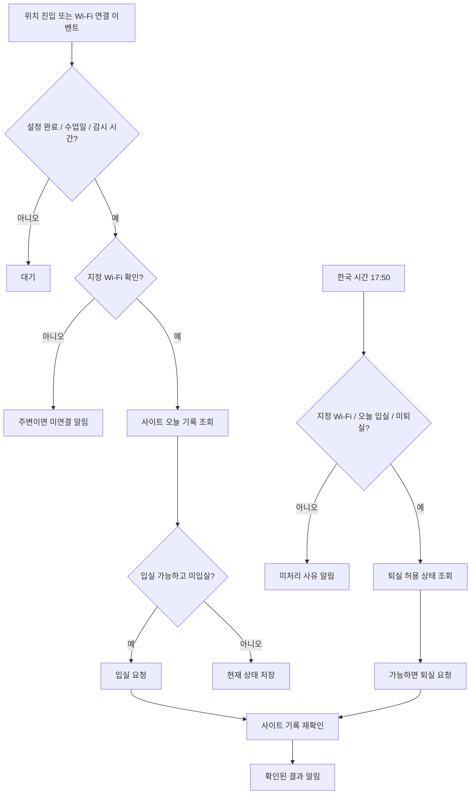

# 앱 구조와 상태 전이

이 문서는 목표 구조와 현재 구현을 함께 설명한다. v0.1.0은 Android 네이티브 Java 앱으로 구현되었다. 위치 감시는 사용자가 시작하는 LocationManager 기반 포그라운드 서비스이며 지오펜스 API로의 전환은 후속 개선이다. 사이트 연동은 공개 코드에서 확인한 네이티브 HTTP 요청을 사용한다. 실제 계정 검증은 남아 있다.

## 구성

| 구성 요소 | 책임 |
| --- | --- |
| 설정 화면 | 위치, Wi-Fi, 수업 일정, 시간대, 자동화 활성 여부 |
| 위치 감지 | 주변 진입·이탈 이벤트 처리, 위치 불확실 상태 구분 |
| 네트워크 감지 | 지정 Wi-Fi 식별과 실제 요청 경로 확인 |
| 실행 조정기 | 일정·위치·네트워크·인증·사이트 상태를 합쳐 처리 여부 판단 |
| 출석 연동기 | 상태 조회, 입실·퇴실 요청, 처리 후 기록 확인 |
| 예약 관리 | 수업일 17:50 예약 및 재부팅·시각 변경 후 복구 |
| 기록 저장소 | 날짜·과정 단위 처리 상태와 미확인 요청 보관 |
| 알림 관리 | 연결 필요, 처리 결과, 재로그인, 권한 부족 안내 |

## 동작 흐름

## 상태

`DISABLED`, `WAITING`, `WIFI_REQUIRED`, `PERMISSION_REQUIRED`, `AUTH_REQUIRED`,
`CHECKIN_WAIT`, `CHECKIN_PENDING`, `CHECKED_IN`, `CHECKOUT_PENDING`,
`CHECKED_OUT`, `RESULT_UNKNOWN`, `FAILED`.

위치 상태(주변 / 외부 / 불명확)와 네트워크 상태(허용 Wi-Fi / 다른 연결 / 확인 불가)는 출석 상태와 별개로 보관한다.
로컬 성공 플래그만으로 사이트의 현재 출석 기록을 대신하지 않는다.

## 중복과 불명확한 결과

1. 과정 식별자, 한국 날짜, 입실·퇴실 종류를 실행 키로 사용한다.
2. 한 실행 키에 대해 동시에 하나의 처리가 진행되도록 잠금을 둔다.
3. 요청 전에 사이트 기록을 조회한다.
4. 요청 직전 처리 진행 상태를 저장한다.
5. 요청 후 서버가 확인한 기록으로 완료를 판정한다.
6. 타임아웃이면 실패로 단정하지 않고 RESULT_UNKNOWN으로 둔다.
7. 결과 불명확 상태에서는 조회를 먼저 수행한다. 이전 요청이 반영됐는지 확인할 수 없으면 자동 재전송을 중단한다.

이 방식은 중복 위험을 줄인다. 사이트가 멱등 요청을 지원하지 않으면 서버와 클라이언트 장애를 통틀어 정확히 한 번 처리를 보장할 수는 없다.

## 사이트 연동 선택

### 우선 검증: 앱 자체 인증과 정상 출석 요청

앱 내에서 로그인한 뒤 실제 페이지가 사용하는 요청과 확인 절차를 재현할 수 있는지 조사한다.
쿠키, CSRF 토큰, 과정 ID, 날짜, 서버 응답을 실제로 확인한 후 구현한다.
가능하다면 잠금 화면에 의존하지 않는 백그라운드 처리를 목표로 한다.

### 대안: 앱 내부 웹 화면

JavaScript 실행이나 화면 상태가 필요한 경우 WebView에서 처리할 수 있는지 검증한다.
WebView가 백그라운드에서 항상 살아 있거나 Chrome 쿠키를 공유한다고 가정하지 않는다.
화면이 잠기거나 프로세스가 종료되는 상황을 실제 기기에서 검증한다.

### 추가 대안: Chrome 화면 조작

Chrome UI 조작이 반드시 필요하면 접근성 기반 처리의 적용 범위를 검토한다.
접근성 권한, 화면 활성 상태, 잠금 해제, UI 변경의 영향을 사용자에게 명확히 표시한다.
이 경로에서는 화면이 잠긴 상태의 완전 자동화를 약속하지 않는다.

v0.1.0은 최초 실행 시 조회 모드로 시작한다. 앱 내 인증 후 사용자가 자동 처리를 켤 수 있다. 실제 사이트 응답과 맞지 않으면 자동 처리를 보류한다.

## Android 실행 수명

- 목표 구조의 지오펜스 감지는 후속 개선이다. 현재는 사용자가 시작한 위치 포그라운드 서비스에서 수신한 좌표의 거리와 정확도·신선도를 확인한다.
- 네트워크 변경은 별도 신호로 사용하되 앱 프로세스가 종료된 동안의 콜백 수신을 당연하게 가정하지 않는다.
- 17:50에는 정확한 알람을 사용하고 권한 거부·철회 상태를 처리한다.
- 짧은 후속 작업, 지연 가능한 재조회, 사용자에게 보이는 감시는 각각 적합한 Android 실행 수단을 선택한다.
- 영구 서비스나 1분 타이머로 모든 백그라운드 제한을 해결할 수 있다고 가정하지 않는다.
- 포그라운드 서비스를 쓰면 실제 작업에 맞는 서비스 유형, 시작 허용 조건, 시간 제한을 검토한다.
- 재부팅, 앱 업데이트, 시간대 변경 시 일정과 미완료 상태를 재평가한다.
- 앱 강제 중지와 권한 철회 후의 복구 절차를 제공한다.

## 네트워크 경로

지정 SSID가 표시되는 것만으로 요청 경로를 확정하지 않는다.
네이티브 요청 경로에서는 확인한 Wi-Fi 네트워크에 요청을 연결하고, 요청 도중 연결이 바뀌면 중단한다.
OS 이동통신 전환이나 VPN의 영향을 현장에서 검증한다.
최종 출석 허용 여부는 사이트 응답으로 확인한다.
