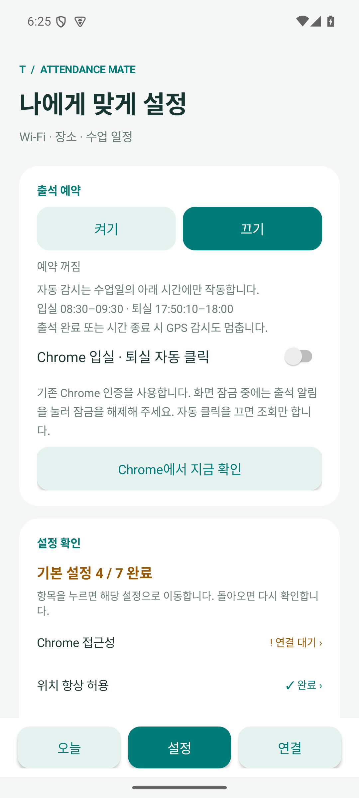

# 출석 예약 버튼과 감시 시간

설정 맨 위의 출석 예약에서 **켜기 / 끄기** 버튼을 선택합니다. 현재 선택한 버튼이 진하게 표시되며 아래에 예약 상태를 표시합니다. 같은 버튼을 다시 눌러도 상태가 반대로 바뀌지 않습니다.

- **켜기:** 필요한 휴대폰 설정을 확인한 뒤 수업일의 다음 출석 시각을 예약합니다. 출석 시간 밖에서는 감시 서비스를 시작하지 않습니다.
- **끄기:** 진행 중인 출석 감시와 다음 예약을 취소합니다. 확인된 출석 기록과 입실·퇴실 완료 알림은 유지합니다.
- **입실:** 설정한 시작부터 종료 시각까지만 감시합니다. 입실 완료가 확인되면 종료하고 다음 퇴실 예약을 기다립니다.
- **퇴실:** 설정한 시각부터 재시도 시간까지 출결과 이탈을 확인합니다. 퇴실 완료 또는 재시도 종료 시 감시를 종료합니다. 기본값은 17:50:10–18:00입니다.
- **GPS:** 입실의 Wi-Fi 안내와 퇴실의 이탈 안내 모두 출석 시간 안에서만 동작합니다. 퇴실 이탈 알림을 한 번 보낸 뒤에는 GPS 감시를 종료하고, 남은 시간에는 출결 재시도만 합니다.
- **수업일 외:** 휴강일과 선택하지 않은 요일은 예약 실행을 건너뜁니다.

앱 안내에는 현재 설정한 입실·퇴실 시간 범위를 표시합니다. 시간 설정을 저장하면 안내도 갱신됩니다. 오늘 화면·출결 달력·설정은 시간 밖에서도 직접 열어 사용할 수 있습니다. 이 제한은 자동 감시에 적용됩니다.

## 종료 시각 직후 실행 요청

감시 종료 직후 새 서비스 실행 요청이 들어오는 상황을 검사하면서 Android의 `ForegroundServiceDidNotStartInTimeException`을 재현했습니다. 서비스 시작 요청이 시간 경계와 겹치더라도 먼저 시스템이 요구하는 시작 절차를 마친 뒤, 위치 요청이나 Chrome 작업 없이 종료하도록 수정했습니다. [Android의 전경 서비스 오류 안내](https://developer.android.com/develop/background-work/services/fgs/troubleshooting#internal-exception-foregroundservicedidnotstartintimeexception)를 참고했습니다.

## 검증

2026-09-11 기준 Java 단위 검사 55개, Android 15 에뮬레이터의 감시 시간·GPS·예약 검사 15개, 기존 출결 알림과 수명 주기 검사 12개, 오늘·설정·월별 달력 화면 검사 16개를 통과했습니다. 실제 알람의 종료 경계와 종료 직후 새 실행 요청을 포함합니다. APK 빌드 성공, lint 오류 0개(기존 Gradle 업데이트 안내 1개).

검사는 모의 위치와 출결 기록으로 진행했으며 실제 출결 서버 요청은 보내지 않았습니다. 실제 휴대폰 설치와 현장 출결은 별도 확인이 필요합니다. v0.6.0에 포함합니다.
