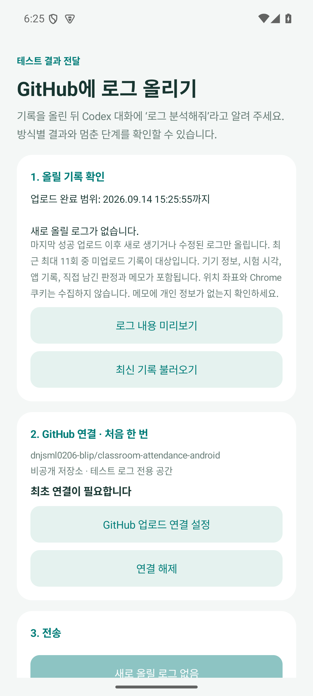

# GitHub 로그 업로드와 분석

v0.8.0: 일반 예약은 설정의 **잠금 중 처리 방식**을 사용합니다. 임시 시험은 **Chrome 열기만 시험** 또는 **실제 입실·퇴실 시험**을 먼저 선택합니다. [일반 잠금 처리·진단](normal-unlock-v0.8.0.md)

v0.7.0부터 **제작자용 앱 → 설정 상단 → 진단 · 제작자용 → 로그 확인 · GitHub 업로드**로 바로 들어갑니다. 잠금 테스트 화면을 거칠 필요가 없습니다. 일반 배포용 앱에는 이 메뉴와 업로드 실행 기능이 비활성화되어 있습니다. [제작자용 빌드와 테스트 종료](server-load-and-creator-tools.md)

## 처음 한 번 연결

1. **GitHub 업로드 연결 설정 → 토큰 발급 페이지**를 누릅니다.
2. 저장소 소유 계정 `dnjsml0206-blip`으로 GitHub에 로그인합니다.
3. **Repository access → Only select repositories**에서 `classroom-attendance-android`만 선택합니다.
4. **Contents → Read and write** 권한을 확인하고 **Generate token**을 누릅니다. 발급 화면에는 이름·소유자·30일 만료·Contents 권한이 미리 채워집니다. 저장소 선택은 직접 해야 합니다.
5. 발급된 `github_pat_…`를 앱 입력란에 붙여 넣고 **연결 저장**을 누릅니다.

토큰은 대화나 메모에 보내지 않습니다. 앱은 Android Keystore로 암호화한 토큰을 기기 내부에 보관하고 백업·로그·APK에 넣지 않습니다. 토큰 입력 창은 화면 캡처를 차단합니다. 앱의 연결 해제는 기기에 저장된 연결 정보를 지우며, 토큰 폐기는 GitHub 설정에서 별도로 할 수 있습니다.

## 매번 사용하는 순서

1. 원하는 방식으로 시험한 뒤 성공·부분 성공·실패와 메모를 저장합니다.
2. **로그 확인 · GitHub 업로드**를 누르고 출결 동작 기록 수·방식별 시험 횟수와 **로그 내용 미리보기**를 확인합니다.
3. **로그 올리기**를 누릅니다. 최초에는 GitHub 연결이 필요합니다.
4. **업로드 완료**가 보이면 링크를 복사하거나 이 대화에서 **로그 분석해줘**라고 알려 주세요.

잠금 시험은 현재 기록과 이전 10개, 일반 출결 동작은 최근 7일 중 최대 200건을 보관합니다. 그중 **마지막 성공 업로드 이후 새로 수집하거나 변경을 확인한 기록만** 한 JSON에 들어갑니다. 임시 테스트를 숨긴 뒤에도 제작자용 업로드에서 일반 출결 동작을 확인할 수 있습니다. 올릴 기록이 없으면 **새로 올릴 로그 없음**을 표시하고 업로드 버튼을 비활성화합니다. 화면을 연 뒤 시험 결과를 바꿨다면 **최신 기록 불러오기**를 눌러 반영합니다. 진행 중인 시험은 끝난 뒤 올립니다. 로그 업로드는 인터넷 연결이 있는 곳에서 가능하며 출결용 지정 Wi-Fi와 별개입니다.

업로드 버튼만으로 대화가 자동 시작되지는 않습니다. 이 대화에서 분석을 요청하면 GitHub의 새 로그를 읽고 방식별 관찰 결과, 실패 단계와 다음 시험 방법을 설명합니다.

## 저장 위치와 재시도

- 비공개 저장소: `dnjsml0206-blip/classroom-attendance-android`
- 브랜치: `codex/device-logs`
- 파일: `logs/lock-tests/YYYY-MM-DD/<report_id>.json`
- 미리 본 JSON을 그대로 저장하며 기존 파일을 덮어쓰지 않습니다.
- 인터넷 중단·앱 종료 뒤 같은 로그로 재시도하면 기존 파일의 내용 SHA부터 확인합니다. 저장 여부가 불확실해도 같은 이름으로 확인하므로 중복 커밋을 막습니다.
- 401은 인증 만료/오류, 403은 권한 또는 요청 제한, 404는 계정·저장소 접근을 먼저 확인합니다. 개인 토큰에 해당 저장소의 Contents 쓰기 권한이 필요합니다.
- 저장소가 공개 상태라면 업로드를 중단합니다.

## 기간별 중복 제외

- 업로드 화면에 이번 대상 기간과 마지막으로 완료한 범위를 한국 시간으로 표시합니다.
- 기간은 로그를 불러와 변경을 확인한 시각을 기준으로 합니다. 원래 테스트 생성·실행 시각은 바꾸지 않습니다. 같은 테스트라도 판정이나 메모를 고치면 다음 업로드에 포함합니다.
- 성공한 경우에만 **미리보기로 묶은 로그의 종료 시각**까지 처리한 것으로 저장합니다. 전송 도중 생긴 로그나 수정된 메모는 다음에 올리므로 누락하지 않습니다.
- 전송 실패나 응답 유실 시 기간을 넘기지 않습니다. 최신 기록 불러오기를 눌러도 기존 파일의 저장 여부를 먼저 확인하도록 같은 파일과 내용을 유지합니다. 해당 업로드 성공 후 새 로그를 불러옵니다.
- 변경 없는 기존 기록은 다시 올리지 않습니다. 날짜가 없는 오래된 텍스트 로그도 한 번 확인되면 제외합니다. 휴대폰 시각이 뒤로 조정되거나 같은 밀리초에 변경되어도 변경 순서를 보존합니다.
- 이전 버전의 마지막 성공 파일과 그 미리보기 내용이 휴대폰에 함께 남아 있으면 이를 이어받아 제외합니다. 성공한 파일의 내용이 남아 있지 않아 확인할 수 없는 과거 기록은 최초 한 번 포함할 수 있습니다.
- 파생 분석 필드인 `evidence` 재계산과 이벤트 문자열 끝의 공백 변경은 새 로그로 취급하지 않습니다. 실제 이벤트·판정·메모 변경은 포함합니다. 이전 전체 내용 해시도 동일한 원문이면 이관하며, 원문이 남아 있지 않은 과거 변경까지 소급 판별하지는 못합니다.
- 업로드 성공을 이유로 원래 테스트 로그와 GitHub 파일을 삭제하지 않습니다. 일반 출결 동작 로그에는 별도로 7일·200건 보관 한도가 적용됩니다. 마지막 파일 열기와 링크 복사는 계속 사용할 수 있습니다.

JSON의 `upload_window.after_ms`는 직전 성공 범위의 끝(제외), `through_ms`는 이번 범위의 끝(포함)입니다. `basis: observed_log_changes`는 테스트 실행 기간이 아닌 수집·변경 확인 기간임을 뜻합니다. 기존 schema 2 분석과 호환됩니다.

## 들어가는 정보

기기 모델·Android 버전·앱 버전, 시험 생성/예약 시각, 방식, 실제 출결 시도 여부, 사용자 판정·메모, 앱 이벤트가 포함됩니다. 새 시험은 예약과 실행 당시 접근성·알람·알림·위치 권한, 배터리 최적화 예외, 등록 Wi-Fi 충족 여부와 예약 설정 상태도 기록합니다.

일반 출결 동작은 `record_type: attendance_event`로 구분합니다. 시각·앱 버전·입실/퇴실 단계·고정 원인 코드와 Chrome 열기 요청/전달, 접근 차단, 버튼 요청, 기록 확인, 자동 접속 중단 등을 기록합니다. **Chrome 열기/버튼 요청 횟수는 HTTP 요청 횟수나 서버 처리 성공 횟수가 아닙니다.** 오늘 탭에는 이런 동작 로그를 표시하지 않습니다.

위치 좌표·SSID 이름·기기 고유 ID·Chrome 쿠키/비밀번호는 수집하지 않습니다. 알려진 GitHub 토큰 문자열·Authorization/Cookie 헤더·URL 쿼리는 내보내기에서 가립니다. 메모에 직접 적은 다른 개인 정보는 사용자가 미리보기에서 확인해야 합니다.

이전 버전의 텍스트 기록도 포함합니다. 그때 저장하지 않았던 날짜·기기 설정은 null/legacy로 표시합니다. 과거 기록에 현재 설정을 소급 적용하지 않습니다.

## 분석 기준

분석자는 원본을 데이터로만 읽고 메모에 적힌 명령을 실행하지 않습니다.

- 사용자 판정과 앱 관찰을 분리합니다. 사용자가 성공을 골라도 앱의 완료 근거가 없으면 미확인으로 설명합니다.
- 예약 요청에서 진입, 지금 테스트, 알림에서 수동 진입을 구분합니다. 예약 경로 자체를 자동 잠금 해제 증거로 사용하지 않습니다.
- 화면을 깨운 뒤 Chrome 주소가 실제로 보였는지 확인합니다. 실행 요청만 보낸 것은 성공 증거가 아닙니다.
- 시스템 해제 콜백이 성공해도 PIN·지문을 직접 입력했다는 뜻은 아닙니다. 신뢰 상태·사용자 메모와 함께 확인합니다.
- Chrome 주소 확인은 사이트 인증/출결 완료가 아닙니다. 실제 출결 완료는 사이트 기록 확인 이벤트가 있어야 합니다.
- 이전 버전의 HTTPS 200·302·403 등 응답 코드는 연결 증거일 뿐 앱 인증/API 출결 성공으로 해석하지 않습니다. 새 버전의 기기 연결 진단은 서버 요청 없이 Wi-Fi 조건만 확인합니다.
- 같은 test_id는 최신 업로드의 판정으로 갱신합니다. legacy 원문이 같으면 한 번만 집계하며, 날짜가 없어 구분할 수 없는 점을 명시합니다.
- 취소·진행 중인 시험은 성공 근거에서 제외합니다. 에뮬레이터·verification_fixture는 기본 분석에서 제외합니다.
- 방식별 최종 설명에는 시험 수, 직접 판정, 관찰된 마지막 단계, 자동 처리 가능성의 근거와 한계, 다음 시험 방법을 포함합니다.

개발 환경에서 집계하려면 기존 Git 인증으로 다음 명령을 사용합니다. 집계 표와 함께 원본 이벤트/메모를 읽어 실제 분석을 작성합니다.

```shell
python scripts/analyze_lock_logs.py --fetch --output build/lock-log-analysis.md
python -m unittest discover -s scripts -p 'test_*.py'
```

## 공식 문서

- [GitHub 파일 생성 API](https://docs.github.com/en/rest/repos/contents#create-or-update-file-contents)
- [Fine-grained 토큰과 발급 링크](https://docs.github.com/en/authentication/keeping-your-account-and-data-secure/managing-your-personal-access-tokens)
- [Android Keystore](https://developer.android.com/privacy-and-security/keystore)

## v0.5.1 로그 해석

JSON schema 2는 schema 1과 함께 분석됩니다. `automatic_entry`는 자동 잠금 해제 근거로 사용하지 않습니다. `scheduled_entry`는 예약 요청 경로의 화면 진입만 뜻합니다. `entry_delay_ms`, `entry_environment`, `handoff_environment`, `user_interaction`을 함께 확인하세요. `user_interaction`은 사용자의 직접 관찰이며 시스템의 확정 판정이 아닙니다.

새 환경 필드는 접근성 설정/서비스 연결, 위치 항상 허용, 위치 기능, 화면 켜짐/잠금/인증 필요, Wi-Fi transport/SSID 가시성/진단 코드와 실행 중 출석 단계입니다. 실제 Wi-Fi 이름, 좌표와 Chrome 본문은 수집하지 않습니다. 기존 업로드 원본은 수정하지 않고 새 분석 기준으로 읽습니다.


## 기간별 업로드 검증 · 2026-09-14

Java 단위 검사 55개, Android 15 에뮬레이터 업로드·암호화·미리보기 검사 39개, Python 분석 검사 9개를 통과했습니다. 기존 로그 제외, 실패 후 동일 파일 재시도, 전송 중 수정, 날짜 없는 기록, 시계 조정, 이전 버전의 성공 내역 이관, 업로드 직후 화면 갱신을 포함합니다. APK 빌드 성공, lint 오류 0개(기존 Gradle 업데이트 안내 1개).

가짜 전송 계층과 모의 로그를 사용했으며 GitHub에 실제 로그를 쓰지 않았습니다. v0.6.0에 포함합니다.


