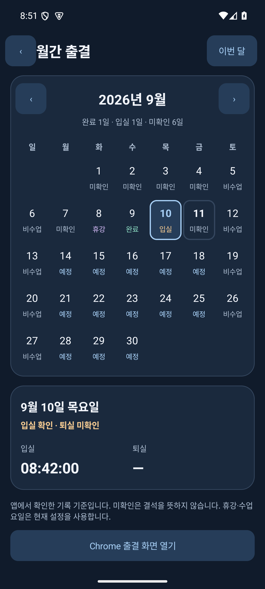
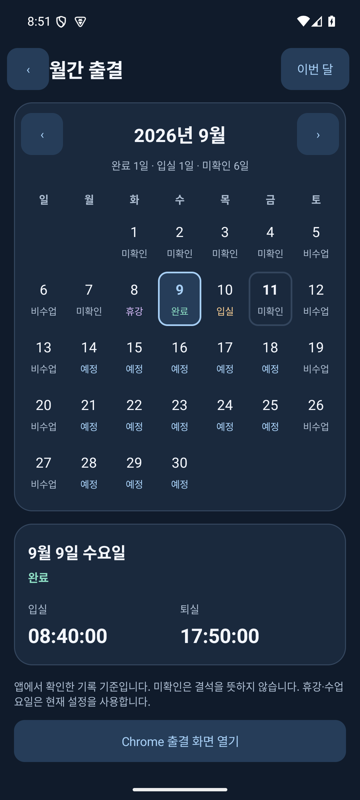
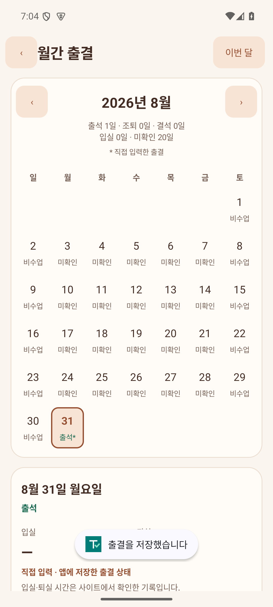
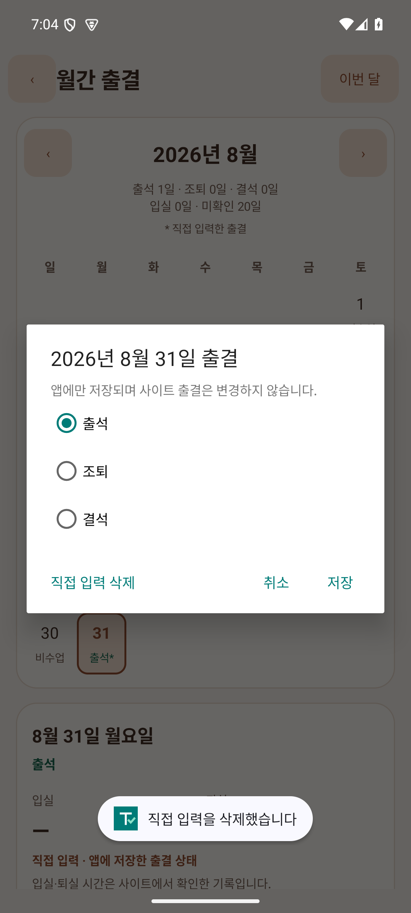
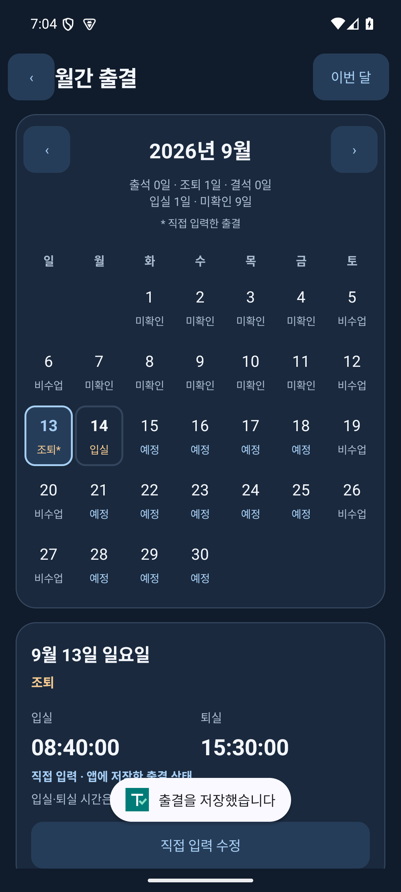

# 월간 출결 달력

오늘 → 달력에서 출결 조회를 누르면 월간 출결 화면이 열립니다. 이전·다음 달 버튼으로 월을 바꾸고, ‘이번 달’로 오늘 날짜를 다시 선택할 수 있습니다. 날짜를 누르면 달력 아래에 해당 날짜와 입실·퇴실 시각을 표시합니다. 시간은 앱이 Chrome에서 확인해 저장한 실제 기록입니다.

| 상태 | 의미 |
|---|---|
| 출석* | 사용자가 지난 날짜를 출석으로 입력함 |
| 조퇴* | 사용자가 지난 날짜를 조퇴로 입력함 |
| 결석* | 사용자가 지난 날짜를 결석으로 입력함 |
| 완료 | 입실과 퇴실 시각이 모두 확인됨 |
| 입실 | 입실 시각만 확인됨 |
| 미확인 | 오늘 또는 지난 수업일에 앱이 확인한 기록이 없음. 결석 확정이 아님 |
| 휴강 | 현재 설정에 휴강일로 등록됨 |
| 예정 | 현재 설정에 따른 미래 수업일 |
| 비수업 | 현재 설정한 수업 요일에 포함되지 않음 |

실제 입실·퇴실 기록은 현재 요일·휴강 설정보다 우선합니다. 예를 들어 출결을 확인한 토요일을 이후 비수업 요일로 바꿔도 그날은 완료 상태로 표시합니다. 지난 수업 일정 변경 이력은 저장하지 않으므로 기록이 없는 날짜의 요일·휴강 표시는 현재 설정 기준입니다.

기록 없는 날짜의 시각은 ‘—’로 표시합니다. 월간 요약은 출석(사이트 완료 + 직접 입력 출석)·조퇴·결석·입실만 확인·미확인 날짜 수를 보여줍니다. 직접 입력한 날짜는 선택한 분류에 한 번만 집계합니다. 달력을 보는 동안 앱의 출결 기록이 갱신되면 표시도 갱신됩니다.

오늘 화면의 ‘오늘 출석 기록’은 오늘 확인된 입실·퇴실 시각만 표시합니다. 설정 변경, Wi-Fi 등록, 감시 시작·종료와 같은 앱 동작 로그를 읽거나 표시하지 않습니다. 서버에서 조회하지 못한 과거 출결을 임의로 채우지 않습니다.

## 지난 날짜 직접 입력 · v0.7.0

1. **오늘 → 달력에서 출결 조회**에서 이전 달로 이동하고 지난 날짜를 누릅니다. 앱 사용 전인 **2026년 8월 31일**부터도 입력할 수 있습니다.
2. 날짜 아래 **출결 직접 기록**을 누르고 **출석 / 조퇴 / 결석** 중 하나를 선택해 저장합니다. 상태를 선택하기 전에는 저장할 수 없습니다.
3. 날짜 칸에 직접 입력 표시(*)와 상태, 상세 화면에 직접 입력 출처가 표시되고 월별 합계가 갱신됩니다. 앱을 다시 열어도 기록이 유지됩니다.
4. **직접 입력 수정**에서 상태를 바꾸거나 **직접 입력 삭제**로 지울 수 있습니다. 삭제하면 기존 사이트 확인 기록으로 돌아가며, 확인 기록이 없으면 현재 수업 요일·휴강 설정에 따른 상태로 돌아갑니다.

직접 입력은 한국 날짜 기준 어제까지 가능합니다. 수업 요일·휴강 설정이 바뀐 과거도 보완할 수 있도록 모든 지난 날짜에 입력을 허용합니다. 오늘과 미래 날짜에는 편집 버튼이 없고 저장 단계에서도 차단합니다.

직접 입력한 상태는 앱에만 저장하며 사이트의 공식 출결을 수정하거나 Chrome 버튼을 누르지 않습니다. 입실·퇴실 시각을 만들어 넣지 않으며 기존 사이트 시각은 유지합니다. 과거 상태는 별도로 저장하므로 오늘 확인 기록·알림·자동 출결 예약·클릭 보류·오늘 동작 로그에 영향을 주지 않습니다. 입력하지 않은 날짜를 자동으로 출석이나 결석 처리하지 않습니다.

## 화면과 검증

2026-09-11 Android 15 에뮬레이터에서 실제 APK를 확인했습니다. Java 검사 56개(월 달력 분류·날짜 배치 3개 포함), 오늘·달력 화면 검사 16개 통과. 날짜별 상태, 시각 표시, 이전·다음 달 이동, 미확인 표시와 설정 로그 제외를 검증했습니다. lint 오류 0개, 기존 Gradle 업데이트 안내 1개. 실제 출결 서버 요청은 수행하지 않았습니다.

 

위 화면의 출결은 에뮬레이터 검증용 예시이며 설치 APK에는 예시 기록을 포함하지 않습니다.

## 직접 입력 검증 · 2026-09-14

v0.7.0에 포함했습니다. 기능 구현 시 아래 검사를 통과했으며, 최종 누적 검증은 [v0.7.0 검증 기록](verification-v0.7.0.md)에 있습니다. Java 단위 검사 61개, Android 15 과거 출결 편집 검사 20개, 기존 오늘·월별 달력 검사 16개로 총 97개를 통과했습니다. 빌드 성공, lint 오류 0개(기존 Gradle 업데이트 안내 1개).

8월 31일 입력, 선택 전 저장 차단, 취소, 세 상태의 저장·수정·합계 반영, 달력 재진입 후 유지, 직접 입력 삭제, 기존 입실·퇴실 시각 보존, 오늘·미래 입력 차단, 오늘 출결·자동 예약·클릭 상태·로그 격리를 확인했습니다. 검증에는 에뮬레이터 예시만 사용했고 원래 설정을 복구했습니다. 이 변경은 아직 GitHub에 푸시하거나 새 APK로 배포하지 않았습니다.

  

