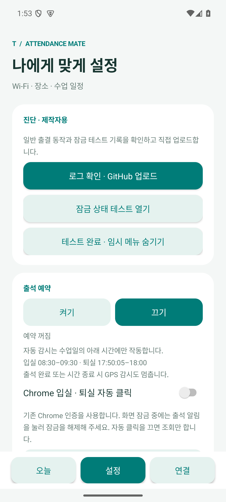
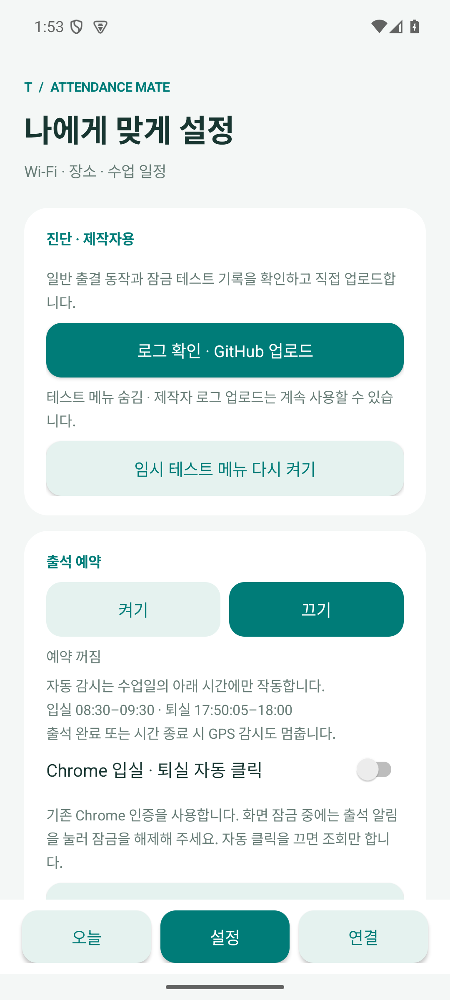
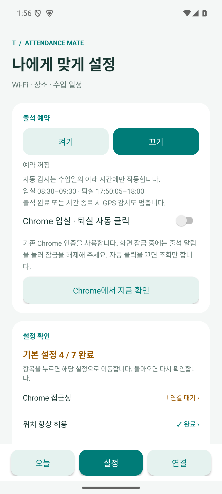
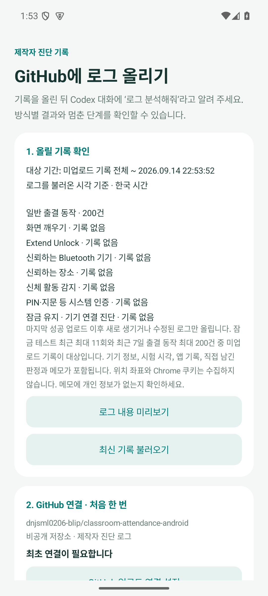

# 접속 제한과 제작자 진단 · v0.7.0

2026-09-14 v0.7.0 변경 내용입니다. 지난 날짜 출석·조퇴·결석 직접 입력과 함께 제공하며, 제작자의 9월 15일 입실 시험용 APK는 비공개 저장소의 릴리스에서 내려받습니다.

## 서버 접속 제한

| 경로 | 적용하는 제한 |
|---|---|
| 앱의 모든 Chrome 출결·인증 화면 열기 | 최소 3초 간격, 기기당 한국 날짜 기준 하루 최대 20회 |
| 자동 출결 및 실제 출결 시험 | 입실·퇴실 각각 하루 최대 3회, 두 번째 접속은 최소 2분 후, 세 번째는 그 뒤 최소 5분 후 |
| 수동 열기·조회 테스트 | 위의 공통 간격과 하루 한도를 공유. 버튼을 연속 눌러도 우회 불가 |
| 사이트 오류 화면·35초 안에 결과 확인 실패 | 해당 날짜·입실 또는 퇴실 단계의 자동 재접속 중단. Chrome에서 직접 확인하도록 안내 |
| 출결 버튼·퇴실 확인 버튼 | 요청을 반복하지 않음. 거절·결과 불명확 시에도 다시 클릭하지 않고 결과 확인을 요청 |
| 잠금 유지 기기 연결 진단 | Wi-Fi 조건을 로컬에서 확인. 기존 인증 페이지 HTTPS 확인 요청 제거 |

횟수와 마지막 접속은 화면을 열기 전에 동기 저장합니다. 앱 재실행·재부팅·예약 껐다 켜기로 초기화되지 않습니다. 같은 부팅 중에는 경과 시각으로 간격을 확인하고 재부팅 후에는 저장된 시각을 사용합니다. 한국 날짜가 앞으로 바뀌면 하루 한도를 새로 시작하며 날짜를 뒤로 조정해도 한도가 늘어나지 않습니다. 앱 데이터 삭제·재설치나 임의의 날짜 조작을 막는 보안 장치는 아닙니다.

자동 오류 중단은 그날 해당 출결 단계에 유지됩니다. 연결 탭의 이전 클릭 보류 해제도 이 접속 제한을 초기화하지 않습니다. 긴급 수동 확인은 Chrome을 직접 열어 진행하세요. 기본 퇴실 시각 17:50:05와 감시 종료 시각은 유지합니다.

이는 **앱이 요청하는 페이지 열기 횟수**의 제한입니다. 한 번 열린 사이트가 내부에서 여러 HTTP 요청을 보낼 수 있고, 사용자가 Chrome에서 직접 여는 페이지나 다른 수강생의 트래픽은 제어하지 않습니다. 서버가 무부하라고 보장하거나 기존 장애의 원인을 확정하는 기능은 아닙니다. 접근성 화면 판독 자체는 로컬 작업입니다. 네트워크 요청은 Chrome의 실제 페이지 이용 또는 제작자의 명시적 GitHub 업로드에서만 발생합니다.

## 기존 로그에서 확인한 부하 우려

9월 11일 및 9월 14일 업로드 원본을 다시 대조했습니다. 중복을 제외한 12개 시험 중 Chrome 열기 요청은 11개입니다. 금요일 17:52:43·48·52·57에는 즉시 조회 시험으로 14초 안에 Chrome 열기 4회가 기록됐습니다. 당시 수동 확인과 즉시 테스트에는 자동 경로의 접속 간격이 공통 적용되지 않아 반복 실행을 막지 못했습니다. 이전 코드의 보완 대상입니다.

기존 저장 사이트 HTML에서는 페이지 로드 후 IP·과정·기간·출석 기록·누적시간을 여러 조회 요청으로 읽습니다. 따라서 페이지 4회가 HTTP 4회라는 뜻은 아닙니다. 다만 기기 로그에 실제 HTTP 요청 수·응답 지연·서버 오류 정보가 없어 이 실행이 장애를 일으켰다고 판단할 수는 없습니다. 접근성의 300–700ms 화면 판독은 로컬 작업으로, 같은 주기의 서버 요청 증거가 아닙니다.

9월 14일 18:00에 내보낸 파일의 11개 시험은 모두 9월 11일 실행입니다. 당시 버전은 일반 자동 출결 이력을 업로드하지 않았으므로 월요일 실행량이나 영향을 배제할 수도 없습니다. 원인을 확정하려면 장애 시각과 운영사 HTTP·DB 기록을 대조해야 합니다.

[9월 14일 업로드 원본](https://github.com/dnjsml0206-blip/classroom-attendance-android/blob/11836932fb52bcac06dd506c1c049760b8689edc/logs/lock-tests/2026-09-14/c9be3a6f-d722-4855-8f93-78df997bab22.json) · [금요일 오전 원본](https://github.com/dnjsml0206-blip/classroom-attendance-android/blob/11836932fb52bcac06dd506c1c049760b8689edc/logs/lock-tests/2026-09-11/fcc4126e-c5a1-4c37-9ba2-80fc6a51f5df.json)

사용자 요청으로 공통 페이지 열기 간격을 60초에서 **3초**로 조정했습니다. 3초 제한은 위의 14초·4회 조회 패턴 자체를 막지는 않습니다. 자동 재시도는 별도로 2분·5분 대기, 단계별 3회 한도와 오류 시 중단을 적용하며, 3초마다 자동 접속하는 방식으로 변경한 것은 아닙니다. 이번 검증에서도 실제 출석 서버를 호출하지 않습니다.

## 제작자용과 일반 배포용

| 항목 | 일반 배포용 | 제작자용 |
|---|---|---|
| 빌드 옵션 | 기본값 또는 `-PcreatorTools=false` | `-PcreatorTools=true` |
| 설정의 진단 카드·업로드 버튼 | 없음 | 설정 상단에 표시 |
| 임시 테스트·업로드 Activity와 테스트 Receiver | Manifest에서 비활성화 | 사용 가능, 외부 앱에는 미노출 |
| 업로드 준비·전송 API | 런타임에서도 차단 | 직접 미리보기 후 전송 |
| 출결 기록 및 로컬 동작 로그 | 유지 | 유지 |
| 테스트 완료 | 임시 메뉴 자체 없음 | 예약·테스트 알림 정리 후 테스트 메뉴 숨김, 별도 업로드 유지 |

제작자 앱에서 **설정 → 진단 · 제작자용 → 테스트 완료 · 임시 메뉴 숨기기**를 누르세요. 같은 카드의 **로그 확인 · GitHub 업로드**는 계속 사용할 수 있습니다. 필요한 경우 **임시 테스트 메뉴 다시 켜기**로 복구합니다.

일반 앱의 환경설정 값을 바꾸는 것만으로 제작자 기능이 켜지지 않습니다. 제작자 APK는 이번 비공개 저장소의 시험용 릴리스에 첨부하며 일반 공개 배포에는 포함하지 않습니다. 제작자 APK 자체가 사용자 신원을 인증하는 것은 아니며, 실제 업로드에는 제작자 개인 GitHub 토큰과 비공개 저장소의 쓰기 권한이 추가로 필요합니다. APK에 토큰을 넣지 않습니다. CI는 두 구성을 검증하지만 일반 배포용 APK만 아티팩트로 남깁니다.

```shell
# 일반 배포용
./gradlew testDebugUnitTest lintDebug assembleDebug -PcreatorTools=false
# 제작자용: 앞의 APK를 보관한 다음 실행
./gradlew testDebugUnitTest lintDebug assembleDebug -PcreatorTools=true
```

두 구성은 동일한 앱 ID·서명을 사용하므로 서로 업데이트 설치하며 기록을 유지합니다. 동시 설치 구성은 아닙니다. 출력 파일 경로도 같으므로 빌드마다 별도 보관해야 합니다. v0.7.0의 versionCode는 13이며, 기존 APK와 같은 인증서로 서명합니다.

## 진단 로그와 분석

일반 출결의 Chrome 열기 요청·전달, 버튼 요청, 사이트 기록 확인, 접속 차단과 자동 중단을 고정 코드·시각·단계·앱 버전으로 남깁니다. 최근 7일 중 최대 200건이며 연속된 같은 상태는 추가하지 않습니다. 페이지 본문·인증 정보·좌표·SSID 이름을 추가 수집하지 않습니다. 출결에 대한 사용자 화면 기록과 별도 저장하므로 오늘 탭에 설정·감시 로그가 섞이지 않습니다.

업로드는 임시 시험 최대 11건과 일반 동작 로그 중 마지막 성공 범위 이후 새로 관찰한 기록·수정만 포함합니다. 파생 `evidence` 변경과 이벤트 끝의 공백만 바뀐 경우는 제외합니다. 업로드 실패 시 같은 파일로 재시도하며 성공 전에는 범위를 넘기지 않습니다. 분석 스크립트는 일반 출결 이벤트와 잠금 시험을 별도로 집계합니다. Chrome 실행 요청·UI 클릭 접수만으로 실제 HTTP 횟수나 출석 성공을 추정하지 않습니다.

[업로드 사용법과 보관·중복 제외 상세](github-log-upload.md)

## 검증

최종 **3초 간격** 코드로 아래 검사를 완료했습니다. 지난 검사에서 환경 문제로 미완료였던 일반용·제작자용 기기 검사도 이번에 모두 실행했습니다.

- Java 단위 검사 **68개**, Python 분석 검사 **10개** 통과.
- Android 15 기기 검사 **165개** 통과: 제작자용 접속·메뉴 31, 일반용 접속·업로드 차단 28, 업로드·암호화 39, 잠금 테스트 19, 지난 출결 달력 20, 오늘 테마 16, 예약·알림 12.
- 2.999초에는 수동 열기를 막고 3.000초에는 허용하며, 조회 테스트도 마지막 열기부터 3초를 공유하는 경계를 실제 저장 계층에서 확인했습니다. 자동 재시도의 2분·5분 대기는 그대로 검증했습니다.
- 일반용·제작자용 각각 APK 및 테스트 APK 빌드 성공, lint 오류 0개(기존 Gradle 업데이트 안내 1개). 두 APK 서명 검증 통과, 기존 설치와 같은 인증서입니다.
- 실제 출결 HTTP, Chrome 페이지 열기, GitHub 업로드를 수행하지 않았습니다. 가짜 전송 계층·미등록 Wi-Fi·모의 출결 데이터로 검사했습니다. 검사 후 설정을 복구하고 전용 에뮬레이터를 종료합니다.
- v0.7.0 APK로 버전을 갱신한 후 두 구성의 단위 검사·lint·빌드를 다시 확인합니다. 최종 파일 정보와 서명은 [릴리스 검증 기록](verification-v0.7.0.md)에 정리합니다.

아래는 버전 갱신 전에 전체 Android 검사를 수행한 로컬 후보입니다. 릴리스 설치파일은 위 검증 기록을 참고하세요.

| 검증 당시 로컬 후보 | 경로 | SHA-256 |
|---|---|---|
| 제작자용 | `build/traffic-creator/classroom-attendance-creator-candidate.apk` | `447f73635b0be226d95a9206da68f06e9fbf864fc434e9b2850e3f6c50429dfc` |
| 일반용 | `build/traffic-public/classroom-attendance-public-candidate.apk` | `35a77c4b4642d016aa64191b3f0d00702f03716408542f5ca7b6c6f02df6d35e` |

## 검증 화면

실제 에뮬레이터 화면입니다. 출결·로그·권한 상태는 검증용 데이터입니다.

<p> </p>
<p> </p>
