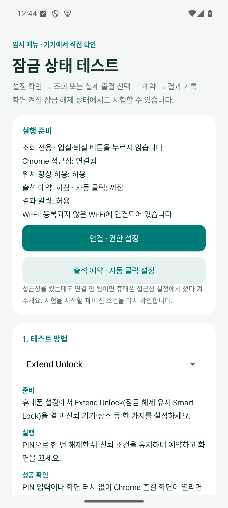

# v0.5.1 검증 기록

2026-09-11. Android 15 / API 35 로컬 에뮬레이터에서 검증했습니다. 실제 휴대폰의 Extend Unlock과 강의실 Wi-Fi 출석 제출은 아직 시험하지 않았습니다.

- Java 단위 검사: 47개 통과.
- 로그 분석기 Python 검사: 9개 통과. 기존 schema 1의 예약 진입을 자동 잠금 해제 성공으로 해석하지 않는 회귀 검사 포함.
- 잠금 테스트 수명주기: 18개 통과. 접근성 연결, 필수 조건 차단, 오늘 퇴실 시각 예약, 예약 대기 중 기존 감시 유지, 조기 실행 방지, 취소·만료, 수동 조작 기록 보존.
- JSON·업로드·자격 증명: 16개 통과. schema 2 진단 필드 및 예약 경로 표시 검사 포함. 가짜 전송과 합성 데이터 사용.
- 기존 출석 수명주기·알림: 12개 통과. Wi-Fi 실패 알림, 확인된 입실/퇴실 알림 유지, 휴강일, 감시 종료 확인. 실제 사이트 제출 없음.
- lint: 오류 0개, 기존 Gradle 업데이트 안내 1개.
- build: assembleDebug / assembleDebugAndroidTest 성공.
- 실제 업로드 로그 8건을 새 분석기로 재분석해 접근성 미연결·조회 조건으로 분류함. 원본 로그는 변경하지 않음.

APK: `classroom-attendance-0.5.1-debug.apk` (4,477,034 bytes)

SHA-256: `68fea14c7b51aebdafea073561d50d213970b6daea71d4a4b3f4d1b2f0f4e21b`

서명 인증서 SHA-256: `9f2973a9e4c72cdbc3304b649a62f48775ecd7b6b5542e9667e6d7711ffefc2a` (기존 릴리스와 일치).

기기 검사 도구가 앱을 재시작하면서 접근성을 끊는 환경 문제는 에뮬레이터 검사 준비 단계에서 서비스 재연결 후 실행하도록 수정했습니다. 앱의 사용자 권한을 자동으로 켜는 기능은 없습니다.

위 이미지는 에뮬레이터에서 실제 APK를 실행한 화면입니다. Wi-Fi 미등록과 예약/자동 클릭 꺼짐은 검사 조건입니다. 설치 APK에는 이 검사 설정과 기록이 포함되지 않습니다.
