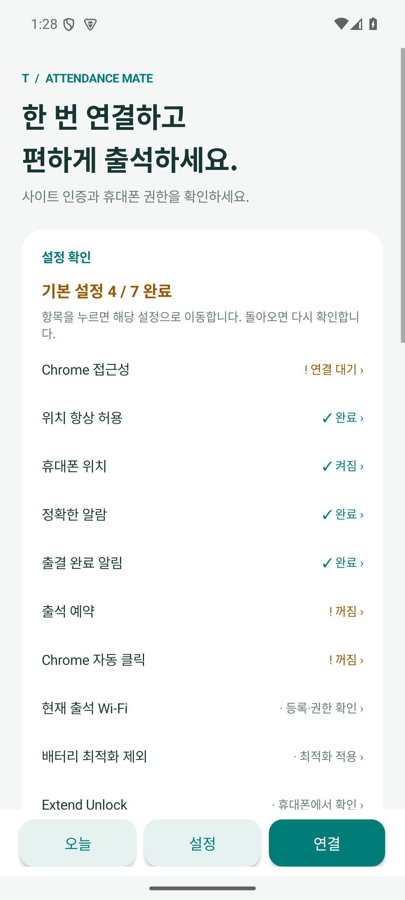

# v0.5.2 검증 기록

2026-09-11. Android 15 / API 35 에뮬레이터에서 검증했습니다. 실제 갤럭시 Extend Unlock과 강의실 출석 제출은 사용자 시험이 필요합니다.

- Java 단위 검사 47개, Python 로그 분석 검사 9개 통과.
- 설정 표시·바로가기 검사 12개 통과: 실제 상태 갱신, Extend Unlock 미확정 표시, 빠진 조건별 연결, 앱별 알림 채널·알람·배터리·접근성 화면 이동, 위치 권한 유지.
- 위치 바로가기는 앱별 권한 화면 도달을 확인했습니다. 이 에뮬레이터에서는 그 화면의 노드를 앱이 읽지 못해 마지막 위치 항목은 직접 선택해야 합니다. 위치 허용 선택 화면까지 자동 이동한 것으로 집계하지 않았습니다.
- 잠금 테스트 18개, 업로드·자격 증명 16개, 출석 수명주기·알림 12개 통과. 업로드는 가짜 전송과 합성 데이터를 사용했고 실제 출결 서버 요청은 없었습니다.
- 총 114개 검사 통과. lint 오류 0개, 기존 Gradle 업데이트 안내 1개.
- assembleDebug / assembleDebugAndroidTest 성공. APK 업데이트 설치 확인.

APK: `classroom-attendance-0.5.2-debug.apk` (4,491,880 bytes)

SHA-256: `3d8767c8b8ac64e8c1ec2fa00ec28e13c8c50933576c67bf007010ba2c77bf8d`

서명 인증서 SHA-256: `9f2973a9e4c72cdbc3304b649a62f48775ecd7b6b5542e9667e6d7711ffefc2a` (기존 릴리스와 일치).

업데이트 후 접근성 항목이 ‘연결 대기’에 계속 머무르면 휴대폰 설정에서 출석 메이트 접근성을 껐다 켜서 연결을 확인하세요. APK 설치 시 기존 임시 테스트 예약은 취소되므로 오늘 17:50 퇴실 시험도 설치 후 다시 예약해야 합니다.

에뮬레이터의 실제 캡처입니다. 예약·자동 클릭 꺼짐과 Wi-Fi 미등록은 검증 환경의 상태이며 설치 APK에 예시 설정을 포함하지 않습니다.
