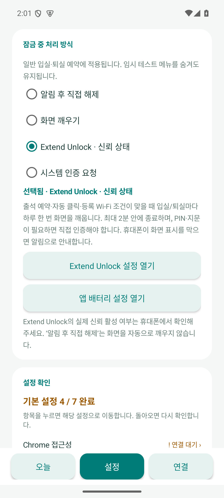
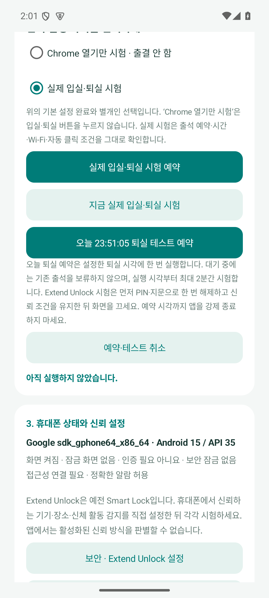

# v0.8.0 검증 기록

2026-09-15. 일반 예약의 잠금 처리, 시험 목적 선택, 알람·Chrome 단계 진단을 versionName 0.8.0 / versionCode 14로 검증했습니다.

## 최종 검사

- Java 단위 검사 77개, Python 분석 검사 12개 통과.
- Android 15 / API 35 에뮬레이터 검사 230개 통과: 제작자 일반 잠금·진단 45, 일반용 잠금·진단 40, 제작자 접속 제한 31, 일반용 접속·업로드 차단 28, 로그 업로드·암호화 39, 임시 잠금 시험 19, 오늘 테마·출결 전용 표시 16, 예약·완료 알림 12.
- 합계 319개 검사 통과. Android 검사는 아래 최종 APK를 설치한 뒤 수행했습니다.
- 두 구성 각각 `testDebugUnitTest lintDebug assembleDebug assembleDebugAndroidTest` 성공. lint 오류 0개, 기존 Android Gradle Plugin 업데이트 안내 1개씩.
- 최종 Manifest에서 일반 잠금 Activity가 두 구성 모두 활성·비공개이고, 제작자 Activity·Receiver는 일반용에서 비활성임을 확인했습니다.

## 실제 화면 전환 검사와 범위

전용 에뮬레이터에서 전원 키로 화면을 실제로 끈 뒤 연결된 접근성 서비스로 일반 예약용 Activity를 실행했습니다. 화면 켜짐, Android Keyguard 해제, 기존 AttendanceEngine 연결까지 두 구성 모두 통과했습니다. 에뮬레이터에는 PIN이 없으므로 Galaxy의 Extend Unlock 신뢰 판정이나 Android 16 보안 잠금 성공을 증명하지는 않습니다.

일반 잠금 모드 선택이 예약·자동 클릭을 임의로 켜지 않는지, 하루·입실/퇴실별 1회 제한이 설정 변경·재시작·날짜 되돌리기에도 유지되는지, 만료·재부팅·다른 Wi-Fi에서 Chrome 연결이 막히는지 확인했습니다. 알람의 예정 시각은 수신 전에 환경 설정이 바뀌어도 Intent에 저장된 값으로 확인합니다.

부팅 직후 한 검사에서는 다른 시스템 앱들의 ANR 및 System UI의 ‘응답 없음’ 창이 포커스를 차지해 화면 연결 검사가 실패했습니다. 화면 덤프로 외부 창을 확인하고 에뮬레이터에서 대기를 선택한 뒤, 정상 포커스의 같은 최종 APK로 제작자·일반용 검사가 통과했습니다. 앱의 시간 제한이나 잠금 조건을 완화하지 않았습니다. 초기 실패 로그와 시스템 창 확인 기록도 로컬 빌드 폴더에 보관했습니다.

나머지 검사는 미등록 Wi-Fi·모의 출결·가짜 업로드 전송을 사용했습니다. 실제 화면 전환 검사에서는 에뮬레이터 Wi-Fi를 임시 등록하되 기존 하루 접속 한도를 이미 소진한 상태로 두어 연결 직후 Chrome 실행을 차단했습니다. 실제 출석 사이트 호출이나 입실·퇴실 클릭은 없었습니다. 변경한 검사 설정과 접근성 설정은 복구합니다.

## 설치파일

| 구성 | 파일 | bytes | SHA-256 |
|---|---|---:|---|
| creator | `classroom-attendance-0.8.0-creator-debug.apk` | 4,568,952 | `309044ac2b18d0f8449ca14f99490c7c4107ff0fd0110c568582cfefc19cc966` |
| public | `classroom-attendance-0.8.0-public-debug.apk` | 4,568,949 | `c33e5038e9b9199f0d3574b237fd0d65bd7456296ed30d2aca6b5630eabca415` |

공통 서명 인증서 SHA-256: `9f2973a9e4c72cdbc3304b649a62f48775ecd7b6b5542e9667e6d7711ffefc2a`. 기존 설치 파일과 같은 서명이며 앱 삭제 없이 업데이트 설치합니다. 로컬 서명한 제작자 시험용 APK와 해시 파일을 비공개 GitHub 릴리스에 첨부합니다. CI의 임시 debug 서명 파일은 이 업데이트 설치파일과 구분합니다.

## 화면 확인

에뮬레이터의 모의 설정 화면입니다. 아래 시험 화면의 23:51은 검사용 설정이며 실제 기본 퇴실은 17:50:05입니다.

[설치 후 설정과 시험](releases/v0.8.0.md) · [동작 제한과 진단 항목](normal-unlock-v0.8.0.md)
