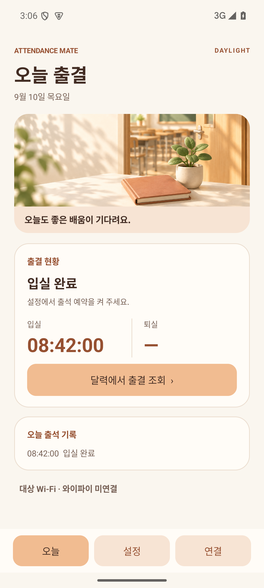
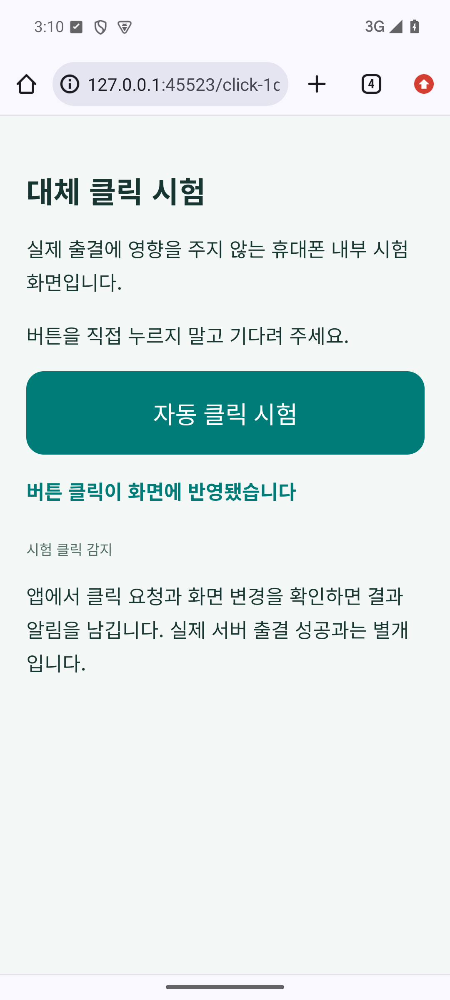

# v0.9.0 검증 기록

2026-09-15. 설정 카드 순서·자동 잠금 기본값·오늘 Wi-Fi 인식 표시·실제 출결 없는 Chrome 대체 클릭 시험을 검증했습니다. versionName 0.9.0 / versionCode 15.

## 검사 결과

- Java 단위 검사 81개, Python 로그 분석 검사 14개 통과.
- Android 15 / API 35 에뮬레이터 검사 167개 통과: 실제 Chrome 대체 클릭·화면 꺼짐 예약·새 UI 22, 임시 잠금 시험 19, 업로드·암호화 39, 제작자 접속 제한 31, 일반용 제한·업로드 차단 28, 오늘 화면 16, 예약·완료 알림 12.
- 합계 262개 검사 통과. 최종 APK에서 즉시 및 화면 꺼짐 예약 대체 클릭과 일반용 차단을 확인했습니다. 나머지 회귀 검사는 같은 기능 코드로 수행했으며 이후 수정은 시험 HTML의 식별값 표시 제거와 번역 방지뿐입니다. 이 최종 변경 후 두 구성 모두 단위 검사·lint·APK 빌드를 다시 통과했습니다.
- 제작자·일반용 각각 `testDebugUnitTest lintDebug assembleDebug assembleDebugAndroidTest` 성공. lint 오류 0개, 기존 Android Gradle Plugin 업데이트 안내 1개씩.
- 최종 APK 버전·같은 업데이트 서명과 Manifest의 제작자 기능 차단을 확인했습니다.

## 관찰한 동작

즉시 시험에서 Chrome이 휴대폰 내부 페이지를 열고 시험 버튼을 자동으로 눌렀습니다. UI 클릭 접수 후 페이지의 변경된 표시를 읽어 SUCCESS를 저장했습니다. 이어서 실제 정확한 알람으로 15초 후 시험을 예약하고 화면을 전원 키로 껐습니다. 알람 수신 당시 화면 꺼짐 기록, 시스템 잠금 해제, Chrome 버튼 클릭, 화면 변경 확인, 성공 알림을 확인했습니다. 기기에는 PIN이 없으므로 Galaxy / Android 16의 Extend Unlock이나 보안 인증 성공을 보장하지 않습니다.

시험 동안 일반 출석 예약·자동 클릭은 OFF, 등록 Wi-Fi는 불일치, 실제 출석 페이지 한도는 이미 소진한 상태였습니다. 대체 시험은 이 조건에서도 실행되며 출결 기록을 생성하지 않았습니다. 실제 출결 URL을 열거나 입실·퇴실을 제출하지 않았습니다. 일반 서버 접속 한도도 바꾸지 않았습니다. 실패·취소 결과는 이전 성공 표시를 재사용하지 않는지 확인했습니다.

Wi-Fi 연결이 있어도 모바일 데이터가 기본 경로이면 기존 SSID 보조 조회를 놓치는 사례를 검사에서 발견했습니다. Wi-Fi 전송망이 하나일 때 해당 연결의 이름을 읽도록 보완했고, 일치/불일치 상태가 오늘 화면에서 바뀌는 것을 확인했습니다. 이름을 인식해도 인터넷 미검증 또는 기본 통신 경로 불일치이면 실제 출석은 차단됩니다.

로컬 페이지는 127.0.0.1과 해당 시험의 임시 포트·UUID 경로만 사용합니다. 다른 경로·Host·메서드는 페이지를 제공하지 않으며 외부 리소스 요청·실제 출결 API가 없습니다. 단위 검사에서 경로 판별, 페이지 내용, 종료 후 소켓 닫힘을 확인했습니다. 시험 결과 로그의 LOCAL_CLICK 목적과 자동 판정을 실제 서버 출결로 해석하지 않는지도 검사했습니다.

## APK

| 구성 | 파일 | bytes | SHA-256 |
|---|---|---:|---|
| creator | `classroom-attendance-0.9.0-creator-debug.apk` | 4,586,460 | `010b4812f5cf3150032eff05af5c3b380c1ebd467a0bc700770f855c249dad7c` |
| public | `classroom-attendance-0.9.0-public-debug.apk` | 4,439,446 | `c681c4db036a30a872cc9d94b56bf06d20d4fe516dfb18f1f09a24f54268bb8f` |

서명 인증서 SHA-256: `9f2973a9e4c72cdbc3304b649a62f48775ecd7b6b5542e9667e6d7711ffefc2a`. 이전 배포와 같은 서명으로 기존 앱 위에 설치합니다. 비공개 저장소 릴리스에는 제작자용 APK와 SHA256SUMS-v0.9.0.txt를 첨부합니다.

## 확인 화면

오늘 화면은 날짜·출결 시각을 넣은 에뮬레이터 예시입니다. 대체 시험 화면은 최종 APK의 실제 Chrome 자동 클릭 직후입니다.

[설치와 시험 순서](releases/v0.9.0.md) · [대체 시험 설명](lock-screen-lab.md)
